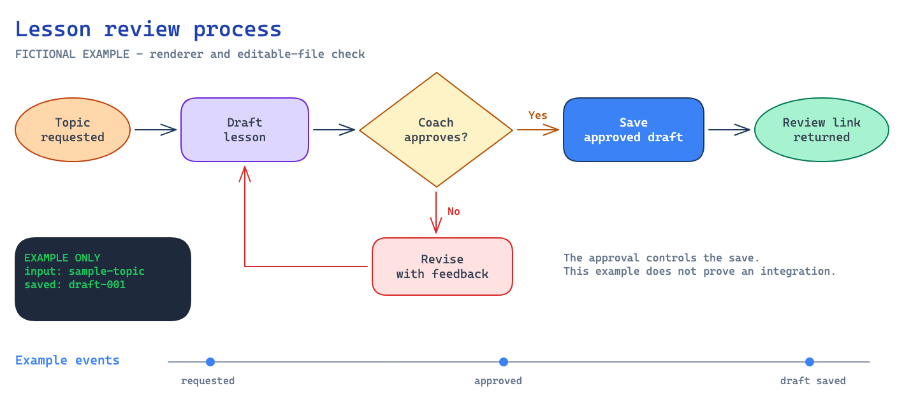

# Coach Skills

23 skills for Claude Code, maintained by Rincon AI. Install the public cinch-coach plugin without a GitHub invitation.

Agent handoffs, process diagrams, and Cinch white papers work with local files. Coaching, email and lesson workflows require your own authorized CinchOS account and the relevant connections. Downloading this package does not grant service access.

Read the [Coach Skills how-to guide](docs/coach-skills-guide.md), [download the illustrated PDF](docs/Coach%20Skills%20Guide%20%28Rincon%20AI%29.pdf), or download the [self-contained HTML](docs/Coach%20Skills%20Guide%20%28Rincon%20AI%29.html) for offline reading. The guide covers setup, examples for every skill, handoffs, and troubleshooting.

## Install

Run these inside Claude Code:

~~~text
/plugin marketplace add jcavnr-collab/coach-skills
/plugin install cinch-coach@coach-skills
~~~

Or run these from a terminal with Claude Code installed:

~~~bash
claude plugin marketplace add jcavnr-collab/coach-skills
claude plugin install cinch-coach@coach-skills
~~~

Follow the reload prompt, then start with:

~~~text
/cinch-coach:coach-setup
~~~

Setup records your own coach identity, connected accounts, planning day, time zone and preferences in your local work instructions. Keep that folder separate from the plugin download.

In Claude Desktop, use the Code tab's plugin management controls to add the same marketplace. This package is for Claude Code; adding a connector to a regular chat does not install these skills. See [Claude's installation guide](https://code.claude.com/docs/en/discover-plugins).

Already using another cinch-coach installation? Disable the older copy through /plugin before enabling this marketplace's copy. Keep your personal instructions and agent briefs.

## Skills

| Skill | Purpose | Needs |
|---|---|---|
| coach-setup | Set up your identity, preferences and work instructions | Local files; optional CinchOS |
| onboard-agent | Start or resume a named assistant from a saved brief | Local files |
| agent-brief | Save decisions, evidence, open work and a handoff | Local files |
| reboot-agent | Move the same assistant into a fresh chat with a verified brief | Local files |
| offboard-agent | Retire an assistant while preserving unfinished work | Local files |
| excalidraw-process-flow-diagram | Create editable process diagrams and PNG/SVG previews | Local renderer setup |
| cinch-whitepaper | Create Cinch-branded white papers and how-to guides as HTML and PDF | Local renderer setup |
| cinchos-guide | Find the right service tools and understand their permissions | CinchOS |
| sunday-prep | Review the roster before your chosen weekly planning day | CinchOS |
| quarter-plan | Design and publish quarter masters | CinchOS plan-editor access |
| apply-week | Apply a published library week | CinchOS and TrainingPeaks |
| athlete-week | Preview and send a week using the athlete's current power PRs | CinchOS and TrainingPeaks |
| custom-week | Build a coach-prescribed taper or custom week | CinchOS and TrainingPeaks |
| roster-check | Review quiet athletes and prepare check-ins | CinchOS |
| prospect-invite | Prepare a personal consult invitation and times | CinchOS |
| consult-report | Draft a Roadmap or To The Moon report | CinchOS |
| comments-by-prompt | Prepare coaching replies for an approved batch send | CinchOS |
| inbox-triage | Read mail and draft replies in the conversation | CinchOS inbox |
| email-drafts | Review and send approved email replies | CinchOS inbox |
| skill-author | Create and revise lesson drafts in Skills Studio | CinchOS Skills Studio access |
| blog-author | Draft, submit and, with publisher permission and confirmation, publish blog articles | CinchOS blog access |
| playbook-author | Plan a playbook from the lesson catalog | CinchOS; manual Studio assembly |
| skills-video-cut | Prepare a rough cut for review | Optional Descript connector |

The CinchOS workflows use Cinch's training vocabulary and tool contracts. They are not a generic TrainingPeaks integration for unrelated organizations. Connected tools and server permissions determine which operations are available to each coach.

Examples use fictional people and illustrative program names. Resolve actual athletes, accounts, programs, dates and recipients from the current coach's instructions and authorized services.

## Connect your services

The plugin includes these MCP server addresses:

- Coaching: https://os.cinchcycling.com/api/mcp/coaching
- Inbox: https://os.cinchcycling.com/api/mcp/inbox

Run /mcp in Claude Code and sign into each needed connection with your own CinchOS account. Never share another coach's login or put credentials in this repository. An owner may see a larger roster, but "my athletes" means the current coach's confirmed assignments.

Skills Studio uses the coaching connection. Its lesson tools are list_skills, get_skill, create_skill_draft and update_skill_draft. Reading requires trainingpeaks:read; draft writes require coaching:draft and active workspace access. Reconnecting cannot grant missing membership. The agent shows the proposed lesson before saving, reads it back, and returns its Studio link. Publication remains a manual Studio action.

The playbook workflow provides an assembly handoff. It does not claim to save a playbook through lesson tools. If your deployment adds playbook tools, inspect their actual contracts before using them.

## Blog articles

~~~text
/cinch-coach:blog-author Turn these notes into a Training Tips article.
Show me the draft and help me choose a photo before saving it.
~~~

Any active coach with blog access can author and submit their own drafts.
Owners, office managers and super admins can publish after seeing and confirming
an exact preview. The workflow also supports revisions, review, withdrawal,
republication and address changes. Images can come from a public URL, a readable
attachment, an existing article, or a desk upload. Hosted video uploads stay on
the desk. The connected server must expose the blog tools; the skill clearly
labels local drafts when it does not.

## Local agents and handoffs

~~~text
/cinch-coach:onboard-agent Alex — help me prepare my coaching week
/cinch-coach:agent-brief checkpoint
/cinch-coach:agent-brief handback
/cinch-coach:reboot-agent Alex
/cinch-coach:offboard-agent Alex
~~~

Briefs belong in your chosen work folder, normally Agents/alex.md, outside this repository and the plugin cache. Reboot saves a brief and provides a prompt for a fresh chat. The new chat reads back the assignment and next action before continuing. Offboarding preserves the final brief and open work.

No voice synthesis skills or ElevenLabs account are required. References to a coach's "voice" in writing workflows mean their written tone.

## Process flow diagrams

~~~text
/cinch-coach:excalidraw-process-flow-diagram Map my athlete onboarding process
~~~

The skill includes a fictional sample, editable Excalidraw source, and a renderer that uses the official Excalidraw export API. Follow the [first-use setup](plugins/cinch-coach/skills/excalidraw-process-flow-diagram/references/setup.md). It needs Python through uv, Playwright, a local browser and internet access for dependencies and fonts. It does not need a paid Excalidraw account.

## Cinch white papers

~~~text
/cinch-coach:cinch-whitepaper Turn my attached notes into a Cinch coaching guide. Keep the facts intact and save the Markdown, HTML, PDF, and page previews in my work folder.
~~~

The skill uses Cinch's ink blue, amber, and teal, with bundled Epilogue and Open Sans fonts. It creates a self-contained HTML file and a Letter PDF, with a PNG of every PDF page for inspection. Follow its [first-use setup](plugins/cinch-coach/skills/cinch-whitepaper/references/setup.md). It needs uv and a local browser; it does not need a paid design service or a voice account. Contact details and a next-step link are optional and supplied for each paper.

See the [two-page fictional sample](docs/examples/cinch-whitepaper-sample.pdf) and its [editable Markdown](plugins/cinch-coach/skills/cinch-whitepaper/assets/sample.md).

## Optional video services

The video-cut skill uses Descript when that connector is available to you. It requires your own account and credits.

Riverside can be connected separately through its [official MCP instructions](https://support.riverside.com/hc/en-us/articles/37803607978141-Connect-to-Riverside-MCP). Check your plan's eligibility and any Claude organization restrictions there. For Claude Code:

~~~bash
claude mcp add --transport http --scope user riverside https://mcp.riverside.com/mcp
~~~

Then use /mcp to sign in. This optional connection does not change the Descript skill into a Riverside skill.

## Updates and downloads

Use /plugin to update the coach-skills marketplace and cinch-coach plugin, then follow the reload prompt. Edition 0.9.0 adds blog authoring, review, image imports and confirmed publication through the coaching connection.

A [versioned ZIP](https://github.com/jcavnr-collab/coach-skills/releases/latest) is also available. Extract it, add the extracted folder as a local marketplace with /plugin marketplace add /absolute/path/to/coach-skills-0.9.0, and install cinch-coach@coach-skills.

## Reuse and contributions

The package's original instructions and code are [MIT licensed](LICENSE). Keep the license notice when sharing or adapting them. Bundled fonts, brand artwork, and downloaded runtime dependencies have their own [notices](THIRD_PARTY_NOTICES.md). This license grants no access to hosted services or ownership of service brands.

Everyone can read, download and fork this repository. Maintainers control changes to the published package. Submit improvements through pull requests with fictional examples; keep athlete records, credentials and personal agent briefs in your own work folder.
