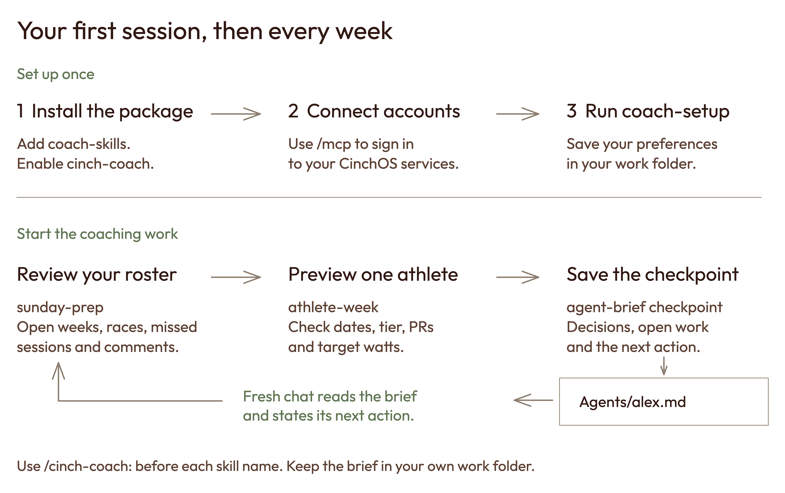
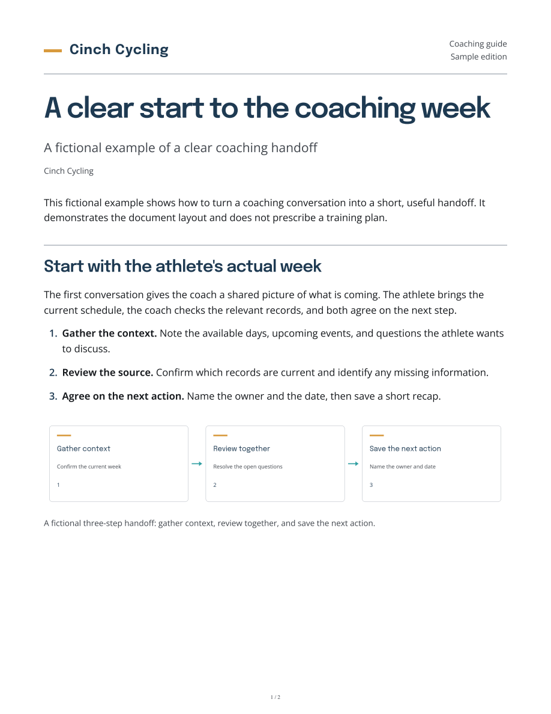

# Coach Skills: a practical guide
### Set up Claude, prepare your coaching week, and carry the work into your next session
*Rincon AI · Guide to cinch-coach 0.9.0 · October 26, 2026*

## Start with one useful job

Coach Skills gives Claude a repeatable way to help with your coaching work. Install the package once, connect your own accounts, and describe the result you want. Each skill supplies the steps for a particular job.

Start with a weekly planning review. It gives you a short list of open weeks, upcoming races, missed sessions and comments waiting for a reply. Then choose one athlete to work on.

The package contains 23 skills. Some use local files, such as agent handoffs, process diagrams and Cinch white papers. Coaching and email workflows use your authorized CinchOS connections. Video editing has its own optional connection.

Two uses of the word **skill** appear in this guide. A **Coach Skill** is an instruction for Claude, such as `athlete-week`. A **Skills Studio lesson** is teaching material for an athlete, such as a cornering drill. The `skill-author` workflow helps you create that teaching material.

The public library is [github.com/jcavnr-collab/coach-skills](https://github.com/jcavnr-collab/coach-skills). You can read it and download the package without a GitHub invitation. Your coaching records stay in your own accounts and work folder.

## Install and connect

### 1. Open Claude Code in your work folder

Use Claude Code in the terminal or the Code area of the Claude desktop app. Choose a folder for your coaching work, such as `Documents/Cinch`. Keep it separate from the downloaded plugin.

If Claude Code is not installed, follow [Anthropic's quickstart](https://code.claude.com/docs/en/quickstart). Sign in with your own Claude account that has Code access. Your Claude account and your CinchOS account are separate sign-ins.

### 2. Add the public package

Run these commands inside a Claude Code session:

```text
/plugin marketplace add jcavnr-collab/coach-skills
/plugin install cinch-coach@coach-skills
```

Complete the install panel if it appears. A user-level installation makes the plugin available across your work folders. Follow the reload prompt.

In the desktop app, use the Code area's plugin controls to add the same marketplace and install `cinch-coach`. [Anthropic's plugin guide](https://code.claude.com/docs/en/discover-plugins) covers the current controls.

If you already have an older `cinch-coach` from a different marketplace, disable that copy in `/plugin` before enabling this one. Preserve your personal instructions and saved agent briefs.

### 3. Sign into the connections

Run `/mcp`. The plugin supplies two CinchOS connections:

| Connection | What you use it for |
|---|---|
| `cinchos-coaching` | Athletes, plans, TrainingPeaks, coaching comments, lessons and blog articles |
| `cinchos-inbox` | Connected email, calendar, consult invitations and reports |

Sign into each connection you need with your own CinchOS account. Your workspace membership and connected TrainingPeaks account determine which actions are available. An owner can see a wider roster; the assistant still needs your confirmed coach assignments when you ask for “my athletes.”

Use this check:

```text
/cinch-coach:cinchos-guide Check my connections. Tell me which
coach identity and email accounts are available, and which
workflows I can use. Start with read-only checks.
```

A failed connection is a setup issue. It does not mean the roster or inbox is empty.

### 4. Save your working preferences

Run:

```text
/cinch-coach:coach-setup
```

The setup conversation covers your role, planning day, time zone, writing style, work folder and coaching vocabulary. It also records how you want proposed changes and messages handled.

Claude shows two instruction files before saving them: your personal `~/.claude/CLAUDE.md` and a `CLAUDE.md` inside the work folder. These describe how you work. Athlete records and account credentials belong in their existing systems.

After the files are saved and read back, open a new session in that work folder. To change a preference later, run setup again or say, “Update my working instructions: I plan on Mondays.”

**Your first useful prompt:**

```text
/cinch-coach:sunday-prep Get me ready for my next planning day.
Show my athletes with an open week, an upcoming race,
missed sessions, or comments waiting.
```

The command keeps its name even if your planning day is Monday or Friday.

## Plan the training week

Use `sunday-prep` for the overview, then pick the workflow that matches the job.

| Job | Skill | Result |
|---|---|---|
| Build or revise the quarter | `quarter-plan` | Quarter masters and published library plans |
| Use a published library week | `apply-week` | Calendar workouts using the library's percent-of-FTP targets |
| Calculate a quarter week from current athlete PRs | `athlete-week` | An athlete-specific preview, then calendar workouts |
| Prescribe a taper or travel week | `custom-week` | A custom week built from your instructions |

### Build the quarter

Give the assistant the source program, quarter name and date range. Quarters run Monday through Sunday.

```text
/cinch-coach:quarter-plan Prepare a quarter called Foundation
for these Monday-to-Sunday dates: [start] to [end].
Use [existing program] as the source. Show the proposed weeks
and the Novice and Advanced versions of the first week.
```

Replace bracketed text with your actual program and dates. The assistant looks up the source and checks whether its intervals are available. If an import is required, it explains the temporary use of the designated import athlete's calendar before proceeding.

Design at Advanced, then inspect how the other tiers are derived. Specify your strength choice. For a plan that handles strength separately, a useful instruction is: “Remove strength from this master, retain core activation, and keep native strength work in TrainingPeaks.”

Publishing creates plans in the coach's TrainingPeaks library. Applying a plan to an athlete is a separate step. The quarter workflow supports the three tiers with strength variants; the preview shows the actual plans it will publish.

### Use current PRs for an athlete's week

Choose `athlete-week` when the prescription is a percentage of a zone's current PR.

```text
/cinch-coach:athlete-week Preview week [number] of [quarter]
for [athlete], Intermediate, without strength. Use the
athlete's current PR window. Show the exact PR duration,
PR date, percentage, watts and existing calendar workouts.
```

Read the calculation, especially the duration. An illustrative prescription of **87% of a 300 W 20-minute PR is 261 W**. A 12-minute PR would be a different input. The percentage, duration and source PR should all match the prescription.

Check which PR window and manual overrides the athlete has saved. A missing zone PR can leave a step using the master's percent-of-FTP target; the preview should identify that fallback. Resolve it before choosing the final week.

The workflow also compares the athlete's FTP with its suggested value. Review a flagged difference before sending. TrainingPeaks stores planned targets relative to FTP, so a later FTP change can move the watts shown on workouts already scheduled.

For a group, give an explicit athlete list and the tier and strength choice for each person. Account access alone does not tell the assistant which athletes share a phase, race schedule or appropriate week.

After a send, ask for the calendar read-back: which workouts landed, which athletes were skipped, and whether anything duplicated an existing session.

### Apply a library week

```text
/cinch-coach:apply-week Preview published week [number] of
[quarter] for [athlete list], Intermediate, without strength.
Show the dates, races and anything already on each calendar.
```

This uses the published library rendition and its percent-of-FTP targets. Pick `athlete-week` when you want targets calculated from each athlete's PRs.

### Make an exception for one athlete

```text
/cinch-coach:custom-week Build a travel week for [athlete]
starting [date]. Tuesday and Thursday are 45-minute easy
rides. Saturday is 90 minutes easy. Show what this replaces.
```

For a taper, supply the race date and your intended taper shape. For illness or injury, supply your coaching decision. The assistant needs your prescription rather than an invented recovery plan.

If a calendar write stops partway, inspect the result and current calendar before repeating it. The skills include replacement and undo paths for work recorded by CinchOS.

## Stay on top of conversations

### Coaching comments and quiet athletes

Use `comments-by-prompt` for replies in the coaching queue. Give a short instruction for each athlete who needs a particular response.

```text
/cinch-coach:comments-by-prompt Show my waiting comments.
For [athlete], acknowledge the pacing improvement and ask
how the last interval felt. Keep the replies short.
```

The output pairs each athlete's comment with the proposed reply. Edit by number or name, then use the displayed batch when giving the send instruction. The result should identify what posted and what failed.

Use `roster-check` to find athletes whose coach contact has gone quiet:

```text
/cinch-coach:roster-check Show athletes due for a check-in,
with the days since contact and a short suggested message.
```

This is a contact review. `sunday-prep` is the broader training-planning review.

### Inbox review and email replies

```text
/cinch-coach:inbox-triage Review the last day of my connected
inbox. Show what needs me today and draft the replies here.
```

The triage summary separates athletes, prospects, business mail and noise. Reply text appears in the conversation. It is not automatically a saved Gmail draft.

Use `email-drafts` to review those replies or existing Gmail drafts:

```text
/cinch-coach:email-drafts Show the final recipients, subjects
and text for the replies from this triage. Make reply 2 shorter.
```

The email workflow handles the send after the final messages are settled. Archiving is its own action. Keep the result visible so you can distinguish a sent message from a draft or a failed attempt.

### Invite a prospect or prepare a report

Use `prospect-invite` when a prospect is ready for a personal consult invitation:

```text
/cinch-coach:prospect-invite Prepare the invitation for
[prospect] using this Loom: [URL]. [Coach] will take the
consult. Show the message and four available times.
```

The workflow uses the selected coach's calendar and the existing invite record. Its send also triggers a notification to that coach. Confirm the named prospect, recipients, coach and times in the preview.

Use `consult-report` for an existing athlete's Roadmap Report or To The Moon Assessment:

```text
/cinch-coach:consult-report Draft a Roadmap Report for
[athlete], focused on [goal event] and climbing progress.
```

Review the report, then finalize it. Finalization saves it to the athlete's timeline and returns a secure link. Delivering that link is a separate action. If the person is still a lead and the report lookup cannot find them, use the prospect invitation flow for the rider report.

## Turn teaching material into lessons

### Draft or revise a Skills Studio lesson

Use your existing teaching notes, a transcript or a video link as the source:

```text
/cinch-coach:skill-author Draft a lesson on [topic] using
these notes: [material]. Check the existing catalog first.
Use its level and category choices. Include drills, common
mistakes and a clear mastery check.
```

Claude reads the lesson catalog and relevant Cinch material, then shows the draft. Once the text is settled, it can save a draft through the coaching connection and return the Skills Studio link. Open that link and review the saved content and readiness items.

For a revision, provide the existing lesson's link and the exact change. The assistant reads the latest version before editing. Published lessons are handled in Studio.

The lesson tools use the existing `cinchos-coaching` connection. A separate Skills MCP connection is unnecessary. Access still depends on active Skills Studio membership. If the tools are absent, the workflow can produce a local Markdown draft and identify that as the saved location.

Video upload, media review and publication happen in Studio. A text draft can be saved while its video remains unfinished.

### Write and publish a blog article

```text
/cinch-coach:blog-author Turn my notes on [topic] into a
Training Tips article for [audience]. Show the draft, help
me add a photo, and save it after I approve the text.
```

Any active coach with blog access can write and submit their own articles.
Claude uses your material and Cinch's knowledge, checks the byline and audience,
then returns the saved draft's desk link. Choose Everyone for a public post;
Community and Athletes keep their existing access rules. A draft save does not
publish it.

Supply a public JPG, PNG or WebP image URL, attach a readable photo, reuse an
existing article image, or upload through the desk. Images must be 5 MB or
smaller. Large attachments may need the URL or desk path. Upload hosted videos
through the desk, then ask Claude to read the article again.

Run the readiness check and resolve any missing items. Coaches submit for
review. Owners, office managers and super admins can publish: Claude shows an
exact preview of the article, audience, address and action, then waits for your
confirmation before making the public change. If the article changes, review a
fresh preview. The same process protects withdrawal, republication and address
changes. Changing an address redirects the old link.

Ask for the saved state and public URL after publication. The public page may
lag by about a minute because of caching. If the connected server lacks the
blog tools, Claude can prepare a clearly labeled local draft; it cannot claim
that draft was saved or published in CinchOS.

### Assemble a playbook

```text
/cinch-coach:playbook-author Plan a [level] playbook for
[goal]. Use the current lesson catalog. Show the lesson order,
Studio links and gaps we need to fill.
```

This workflow produces an ordered assembly handoff in `Skill drafts` inside your work folder. Assemble and publish the playbook in Skills Studio. The handoff identifies published lessons and draft dependencies separately.

Playbook authoring through MCP is not part of this edition's documented workflow. If your deployment adds those tools later, have the assistant inspect the available operations before claiming it saved a Studio playbook.

### Prepare the video

`skills-video-cut` is the package's **Descript** workflow. With your Descript connection available, ask it to prepare a rough cut and review the project in Descript:

```text
/cinch-coach:skills-video-cut Prepare a rough cut of [video]
for the [lesson] project. Confirm the edit style with me.
Return the project for review and a transcript for the lesson.
```

The workflow covers transcript-based cleanup, captions and a teaching-video structure. Descript account access and credits are separate requirements.

**If you use Riverside:** connect it separately using [Riverside's official MCP instructions](https://support.riverside.com/hc/en-us/articles/37803607978141-Connect-to-Riverside-MCP). For Claude Code, run this in your terminal:

```bash
claude mcp add --transport http --scope user riverside https://mcp.riverside.com/mcp
```

Then run `/mcp` inside Claude Code to sign in. Check your Riverside plan's eligibility and your Claude organization's connector settings. Start by asking Riverside to find a recording and read its transcript. A Riverside connection does not convert the Descript skill into a Riverside editing workflow.

The coach package requires no ElevenLabs account. References to your “voice” in writing workflows mean your written tone.

## Keep a named assistant's context

A named assistant can hold a clear assignment across chats when its working context is saved in a brief. Use one work folder and a brief for each assistant.

### Start an assistant

```text
/cinch-coach:onboard-agent Alex. Help me prepare my coaching
week. Use this folder for our work and keep a current brief.
```

The assistant establishes its role, finds any existing brief and records the next action. The usual location is `Agents/alex.md` inside your work folder. Naming an assistant gives the current chat an identity; background scheduling is a separate setup.

### Save progress or hand work back

```text
/cinch-coach:agent-brief checkpoint
```

A checkpoint records decisions, verified results, open work and the next action while the assignment continues. Use `handback` when another chat or successor should take over:

```text
/cinch-coach:agent-brief handback
```

Ask for the saved path and restart prompt. Keep the brief outside the plugin cache and public repository so it survives updates and stays with your work.

### Reboot into a fresh chat

```text
/cinch-coach:reboot-agent Alex
```

The old chat saves and checks the brief, then gives you a restart prompt. Open a fresh Claude Code chat in the same work folder and paste that prompt. It will look like this, with your real path:

```text
/cinch-coach:reboot-agent resume Alex from
/actual/work/folder/Agents/alex.md
```

The fresh chat should read back its identity, assignment, current state and next action. Keep the old chat available until that read-back is right.

If the old chat is unavailable, ask `onboard-agent` to reconstruct the brief from the saved work you do have. The recovered brief should label gaps. Switching computers or accounts also requires transferring supporting files and signing into the needed services.

### Retire an assistant

```text
/cinch-coach:offboard-agent Alex. Save the final handoff
and leave the next owner unassigned.
```

Offboarding records retirement and preserves unfinished work. Use reboot for the same assistant continuing in a new chat. Removing account access or stopping a scheduled job requires its own action.

## Draw a process you can explain

Use Excalidraw Process Flow Diagram to map athlete onboarding, a coaching review, lesson production or an office handoff.

```text
/cinch-coach:excalidraw-process-flow-diagram Map our athlete
onboarding process. Show each owner, the decisions, and what
happens when required information is missing. Ask me about
any step that changes the order. Save it in my work folder.
```

The output includes an editable `.excalidraw` file and PNG/SVG previews. Ask for the editable file as well as the picture, so you can revise the process later.

On the first use, the assistant checks the local renderer setup. It uses Python through `uv`, Playwright and a browser. Internet access is needed for dependencies and fonts. A paid Excalidraw account is optional. Follow the package's [first-use setup](https://github.com/jcavnr-collab/coach-skills/blob/v0.8.0/plugins/cinch-coach/skills/excalidraw-process-flow-diagram/references/setup.md).

Start with the included fictional example. Open the rendered picture and the editable file in Excalidraw. Check that labels are readable, arrows connect to the intended shapes and both decision branches make sense. Then draw your own process.



## Create a Cinch white paper

Use `cinch-whitepaper` to turn your coaching notes into a how-to guide, teaching brief or longer paper in Cinch's colors and fonts.

```text
/cinch-coach:cinch-whitepaper Turn my attached notes into a
Cinch coaching guide. Keep the facts and decisions intact.
Include a short next-action section. Save the editable
Markdown, HTML, PDF and page previews in my work folder.
```

The skill uses deep ink blue, amber and teal, with Epilogue headings and Open Sans body text. Fonts travel with the package. It works locally and needs no paid design or voice service.

On first use, follow the [renderer setup](https://github.com/jcavnr-collab/coach-skills/blob/v0.8.0/plugins/cinch-coach/skills/cinch-whitepaper/references/setup.md). The assistant checks `uv` and the matching browser, then renders the included fictional sample. This is a separate renderer from the process-diagram skill.

Keep the source notes and images with the finished paper. The output includes a self-contained HTML file, a Letter PDF and a picture of every PDF page. Check those pages for readable tables, useful page breaks and correct facts before sharing. Contact details and a next-step link are optional; supply the details you want on this particular paper.



## Find the right skill quickly

Every command begins with `/cinch-coach:`. Add the skill name below and describe the job.

| Skill | Use it when you want to… |
|---|---|
| `coach-setup` | Record your identity, preferences and work folder |
| `cinchos-guide` | Check connections and understand the available workflows |
| `sunday-prep` | See who needs attention before weekly planning |
| `quarter-plan` | Build a quarter and publish plans to your library |
| `apply-week` | Apply a published percent-of-FTP library week |
| `athlete-week` | Preview and send a quarter week using athlete PRs |
| `custom-week` | Prescribe a taper, travel week or other exception |
| `roster-check` | Find quiet athletes and prepare check-ins |
| `comments-by-prompt` | Prepare replies to coaching comments |
| `inbox-triage` | Review unread mail and draft replies in the chat |
| `email-drafts` | Review email replies and complete a send or archive action |
| `prospect-invite` | Prepare a personal consult invitation and times |
| `consult-report` | Draft and finalize an athlete report |
| `skill-author` | Create or revise a Skills Studio lesson draft |
| `blog-author` | Draft, submit and confirm publication of blog articles |
| `playbook-author` | Organize lessons into a playbook assembly handoff |
| `skills-video-cut` | Prepare a teaching-video rough cut through Descript |
| `onboard-agent` | Start or resume a named assistant |
| `agent-brief` | Save progress or prepare a handoff |
| `reboot-agent` | Resume the same assistant in a fresh chat |
| `offboard-agent` | Retire an assistant with a final handoff |
| `excalidraw-process-flow-diagram` | Create an editable process diagram |
| `cinch-whitepaper` | Create a Cinch-branded paper, coaching guide or brief |

## When something needs attention

| What you see | What to do |
|---|---|
| A command is missing | Open `/plugin`, confirm `cinch-coach` is enabled, and follow its reload prompt. |
| The connection asks for sign-in | Open `/mcp` and authenticate the relevant CinchOS connection. |
| An athlete is “not found” | Check spelling, the connected account and that athlete's coach assignment. |
| A write is blocked or forbidden | Give the named error to your CinchOS administrator. Reconnecting alone does not add permission. |
| TrainingPeaks requests reconnection | Reconnect TrainingPeaks in CinchOS Settings, then repeat the read or preview. |
| A save or send has an uncertain result | Read the current record or calendar before retrying. |
| A lesson saved only to a local file | Use the supplied file; check Skills Studio access before expecting a Studio link. |
| A diagram cannot render | Check the package's first-use instructions, matching browser version and network access. |
| A white paper cannot render | Check its first-use setup and keep images inside the source folder. |
| A fresh chat has lost context | Point it to the saved brief and ask for a read-back. |

To update the package, open `/plugin`, update the `coach-skills` marketplace and `cinch-coach`, then follow the reload prompt. Your personal instructions, briefs and diagrams stay in your work folder.

The [release downloads](https://github.com/jcavnr-collab/coach-skills/releases/latest) provide a versioned ZIP. For a local installation, extract it and add that extracted folder as the marketplace, then install `cinch-coach@coach-skills`.

This guide describes the 0.9.0 package. Connected services can change independently. When a live tool differs from the guide, keep the actual result and report the mismatch so the instructions can be updated.

For your first session, finish setup, run the planning review, and preview one athlete's week. Save an agent checkpoint before you leave. That gives the next session a concrete place to begin.
