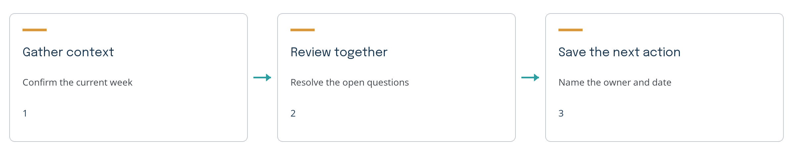

# A clear start to the coaching week

This fictional example shows how to turn a coaching conversation into a short, useful handoff. It demonstrates the document layout and does not prescribe a training plan.

## Start with the athlete's actual week

The first conversation gives the coach a shared picture of what is coming. The athlete brings the current schedule, the coach checks the relevant records, and both agree on the next step.

1. **Gather the context.** Note the available days, upcoming events, and questions the athlete wants to discuss.
2. **Review the source.** Confirm which records are current and identify any missing information.
3. **Agree on the next action.** Name the owner and the date, then save a short recap.



## Make the handoff easy to use

| Item | What to record | Who checks it |
|---|---|---|
| Schedule | The days and constraints the athlete confirmed | Athlete and coach |
| Questions | The specific decisions that still need a conversation | Coach |
| Next action | One action, one owner, and an agreed date | Named owner |

> A useful handoff says what is known, what still needs an answer, and where the next session should begin.

## Save a brief that the next session can use

A clear brief makes it easier to pick up the work without repeating the whole conversation. Keep the source files with the brief so the next person can check what changed.

```text
What we reviewed: the athlete's confirmed schedule and open questions.
What we decided: the next coaching conversation has one named owner.
What remains open: the athlete will confirm the event date.
Next action: read the saved brief, then verify the open item.
```

## Review before sharing

Read the PDF as a recipient would. Check names and dates against the source, look at the diagram, and confirm that the next step is easy to find. A clean export does not establish that the coaching facts are correct.

If the paper contains athlete information, share it through the coach's chosen private channel. The public skills package contains the reusable instructions and fictional examples.

Use the Cinch whitepaper skill with your own notes. The [Coach Skills repository](https://github.com/jcavnr-collab/coach-skills) includes installation instructions and example prompts.
